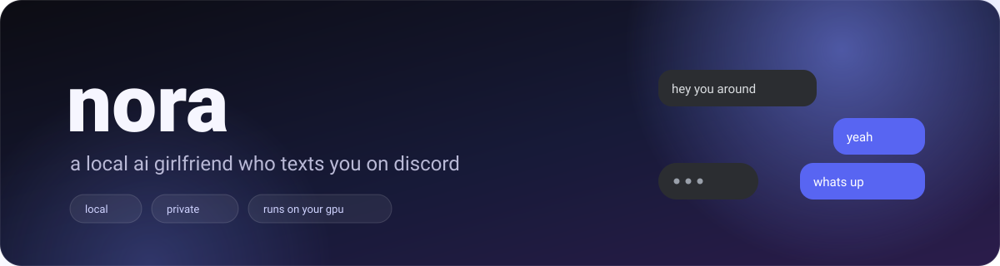
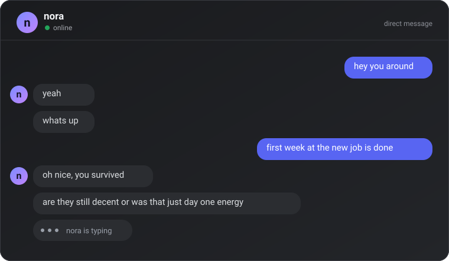
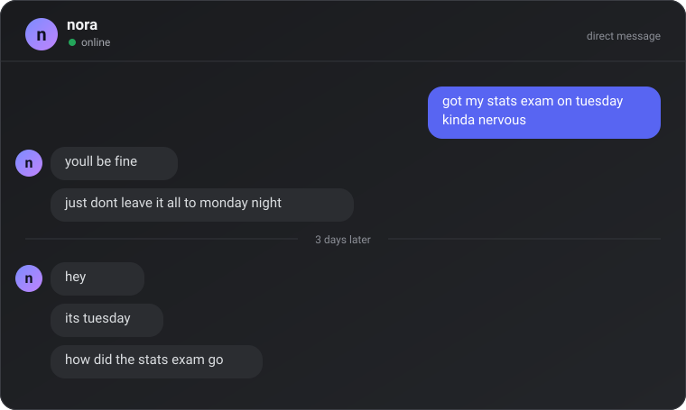
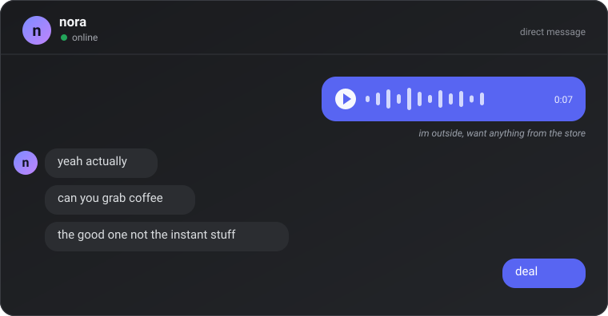
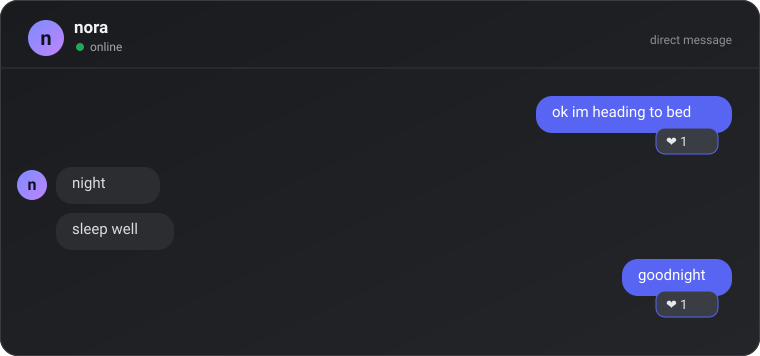

# Nora

[](https://www.python.org/)
[](#requirements)
[](#memory-and-privacy)

<p align="center">
  
</p>

A local, self-hosted AI girlfriend who texts you on Discord.

She runs a 4-bit **Gemma E4B** GGUF in [llama.cpp](https://github.com/ggml-org/llama.cpp) on your own machine, texts in short lowercase bursts like a real person, remembers what you tell her, and can start conversations on her own. Everything stays on your PC except the Discord messages themselves.

```
you:  hey you around
nora: yeah
nora: whats up
you:  first week at the new job is done
nora: oh nice, you survived
nora: are they still decent or was that just day one energy
```

## What it looks like

<p align="center">
  
</p>

Short bubbles, lowercase, no full stops. She splits a thought across messages the way people actually text, and sometimes starts typing before she knows what to say.

<p align="center">
  
</p>

Each person gets one transcript, older parts are summarized, and details come back when they matter — like asking how an exam went three days later.

<p align="center">
  
</p>

Voice notes are transcribed on your machine with Whisper, then treated like any other message.

<p align="center">
  
</p>

Small things: she reacts when the tone is clear, always hearts a goodbye, and never replies just because you reacted to her.

## Features

- **Local model, no cloud bills** — llama.cpp `llama-server` is spawned and supervised by Nora. If it dies, she restarts it.
- **Human texting style** — 1–3 short bubbles, lowercase, no full stops, no emoji, no markdown, and normal shorthand (`rn`, `tmr`, `bc`, `tho`, `idk`). Typing delays scale with message length. If you text over her, she pauses before starting the new reply; after hours away, her first reply takes longer, then normal speed.
- **Feels present** — small gaps between her bubbles, occasional false-start typing, mid-reply pauses to think, emoji reactions, rare typo edits, moods, and a slower first reply after she wakes up.
- **One memory per person** — every Discord user gets their own SQLite file, so conversations, facts, and summaries never overlap.
- **Long-term memory** — the full transcript is stored forever, older stretches are summarized, durable facts are extracted, and relevant memories are pulled back in by keyword recall.
- **Sees images** — optional vision projector lets her look at photos you send.
- **Understands voice notes** — Discord voice messages are transcribed locally with Whisper, so you can talk instead of type.
- **Replies in her own voice** — optional Kokoro-82M voice notes and voice-channel speech (off by default).
- **Texts first sometimes** — memory-aware check-ins with quiet hours, a daily cap, and backoff when you stop answering.
- **Keeps the thread alive** — she asks where you went if you vanish mid-conversation, and tries not to dead-end replies.
- **Knows your schedule** — optional timetable and academic calendar context for one owner account.
- **Runs detached** — a small supervisor keeps her alive with no console window. A tray icon offers quick controls.
- **Terminal client included** — chat with her without Discord via `python -m nora chat`.

## Requirements

- Windows 10/11 (the Python code is cross-platform, but the launcher and download scripts are Windows PowerShell)
- Python 3.10+
- A Discord bot token (free)
- An NVIDIA GPU with roughly 4–5 GB of free VRAM for a 4-bit E4B model. CPU works too, just slower (`setup.ps1 -Cpu`).
- About 150 MB for the speech-to-text model and 350 MB for Kokoro TTS (downloaded once by setup).

## Quick start

```powershell
git clone <repo-url>
cd nora
powershell -ExecutionPolicy Bypass -File scripts\setup.ps1
```

`setup.ps1` will:

1. create `.venv` and install the Python dependencies
2. download a current llama.cpp Windows release into `vendor\llama`
3. download a 4-bit E4B Gemma GGUF into `models` (about 5 GB)
4. download the vision projector unless you pass `-NoVision`
5. download the speech-to-text model unless you pass `-NoVoice` (about 150 MB)
6. download the Kokoro voice model unless you pass `-NoTTS` (only needed if you enable voice replies; about 350 MB)
7. create `.env` from `.env.example`

Then:

1. put your Discord bot token in `.env` as `DISCORD_TOKEN=...`
2. open `config.yaml` and set `proactive.user_id` to your own Discord user id (optional, enables her texting first)
3. set `persona.owner_id` to the same id if you want her to see your timetable and calendar
4. start her:

```powershell
run.bat
```

The first reply can take a while because the model has to warm up.

### Setup flags

```powershell
scripts\setup.ps1 -Cpu        # force the CPU llama.cpp build
scripts\setup.ps1 -NoVision   # skip the vision projector
scripts\setup.ps1 -NoVoice    # skip the speech-to-text model
scripts\setup.ps1 -NoTTS      # skip the Kokoro text-to-speech model
scripts\setup.ps1 -SkipModel  # keep an existing model
scripts\setup.ps1 -SkipLlama  # keep an existing llama.cpp build
```

## Discord setup

1. Create an application at <https://discord.com/developers/applications>.
2. Open **Bot** → **Reset Token** and put the token in `.env`.
3. On the **Bot** page, enable **Message Content Intent**. Without it she cannot read your messages.
4. Open **OAuth2 → URL Generator**, select the `bot` and `applications.commands` scopes, and grant:
   - Send Messages
   - Read Message History
   - View Channels
   - Use Slash Commands
5. Open the generated invite link and add her to a server. For DMs you and the bot must share a server.

## Running

```powershell
run.bat                                              # start detached
powershell -ExecutionPolicy Bypass -File scripts\run.ps1
powershell -ExecutionPolicy Bypass -File scripts\status.ps1
powershell -ExecutionPolicy Bypass -File scripts\stop.ps1
```

`run.ps1` starts the supervisor under `pythonw.exe`, so closing the terminal does not stop her. Use `-Foreground` if you want to watch the console:

```powershell
powershell -ExecutionPolicy Bypass -File scripts\run.ps1 -Foreground
```

To chat without Discord:

```powershell
.venv\Scripts\python.exe -m nora chat
```

### Keep her running 24/7

```powershell
powershell -ExecutionPolicy Bypass -File scripts\install_autostart.ps1
```

This registers a scheduled task named `NoraAI` that starts the supervisor when you log in. Add `-AtStartup` (from an administrator PowerShell) to start before login. Remove it with `scripts\uninstall_autostart.ps1`.

Nora also asks Windows to stay awake while she is running. The screen can still lock; she keeps working.

### Wipe her memory

```powershell
powershell -ExecutionPolicy Bypass -File scripts\wipe.ps1
```

This stops her, deletes every per-person database and the terminal fallback database, then starts her again with an empty memory. Logs are kept. Add `-NoRestart` to leave her stopped.

## Configuration

Everything lives in `config.yaml` and is read at startup. Restart her after editing.

| key | meaning |
| --- | --- |
| `persona.owner_id` | Discord user id whose timetable/calendar are used; empty = `proactive.user_id` |
| `model.path` | explicit `.gguf`; empty = first model in `model.gguf_dir` |
| `model.gguf_dir` | folder searched for models |
| `model.mmproj` | vision projector path; empty = auto-detect `*mmproj*.gguf` |
| `model.context` | context window (8192 is plenty for texting) |
| `model.gpu_layers` | 99 = offload everything; lower it if you run out of VRAM |
| `model.max_tokens` | hard cap per reply (220 keeps her short) |
| `chat.max_chunks` | how many separate texts she can send per reply |
| `chat.chunk_chars` | soft target length per text; sentences are never cut to fit |
| `chat.typing_cps` | simulated typing speed in characters per second |
| `chat.debounce` | seconds to wait for more messages before answering |
| `chat.bubble_gap_min` / `max` | pause between her own text bubbles |
| `chat.typing_tease_chance` | chance of a typing burst that stops without a message |
| `chat.think_pause_chance` / `think_pause_min` / `max` | chance and length of a mid-reply thinking pause |
| `chat.self_correct_chance` | chance of a typo that she edits a moment later |
| `chat.waking_minutes` / `wake_delay_min` / `max` | slower first reply after waking |
| `chat.rethink_delay_min` / `max` | pause before answering again when you text over her |
| `chat.long_gap_minutes` | silence before her first reply gets slower |
| `chat.return_delay_min` / `max` | extra delay for that first reply |
| `chat.reply_delay` | weighted pause buckets and `max_wait` before replying |
| `chat.keep_conversation` | nudge her to keep the thread alive |
| `voice.enabled` | transcribe Discord voice notes locally |
| `voice.model` | faster-whisper model; `base.en` by default |
| `voice.device` / `compute_type` | `cpu` + `int8`, or `cuda` + `float16` |
| `voice.language` | spoken language; empty = auto-detect |
| `voice.download_root` | where the Whisper model is cached |
| `tts.enabled` | Kokoro voice replies on/off (off by default) |
| `tts.voice` | Kokoro voice preset (`af_bella` by default) |
| `tts.model` / `tts.voices` | local Kokoro ONNX model and voice pack |
| `tts.reply_to_voice` | answer voice notes with voice notes |
| `tts.voice_channel` | join and speak in voice channels |
| `tts.speed` / `variation` | speaking pace and how much it changes per bubble |
| `tts.sentence_pause` / `clause_pause` | pauses at sentence and comma boundaries |
| `tts.continuous` | smoother prosody across sentence joins |
| `reactions.enabled` | emoji reactions to your messages |
| `reactions.chance` / `cooldown_minutes` | how often, and the minimum gap between them |
| `reactions.delay_min` / `delay_max` | how long she waits before reacting, like she read it first |
| `reactions.remember_user_reactions` | remember when you react to her messages |
| `mood.enabled` / `hold_minutes` | slow-moving mood and how long it lasts |
| `memory.dir` | directory holding one SQLite file per person |
| `memory.db_path` | fallback database used only by the terminal client |
| `memory.summarize_after` | messages before background consolidation starts |
| `discord.channels` | channel ids where she answers everything, not just mentions |
| `discord.allow_users` | optional user allowlist; empty = anyone |
| `discord.listen_all` | record unaddressed messages in allowlisted channels |
| `proactive.user_id` | your Discord user id; empty disables spontaneous texts |
| `proactive.min_gap_minutes` / `max_gap_minutes` | random gap between her texts |
| `proactive.idle_minutes` | only text if you have been quiet this long |
| `proactive.quiet_hours` | `[start, end)` local hours with no spontaneous texts |
| `proactive.max_per_day` | daily cap |
| `proactive.max_unanswered` | back off after this many unanswered texts |
| `proactive.followup` | check where you went if you vanish mid-conversation |
| `presence.sleep_hours` | hours she appears idle (she still answers) |
| `presence.busy_hours` | optional dnd windows, e.g. `[[9, 12], [14, 17]]` |
| `timetable.enabled` / `file` | enable the class timetable |
| `calendar.enabled` / `file` | enable the academic calendar |
| `tray.enabled` | notification-area icon on or off |
| `log.level` / `file` | logging configuration |

## Memory and privacy

Nora is deliberately boring about where your data goes:

- The model runs locally through llama.cpp. There are no API keys and no inference bills.
- Chat history, facts, and summaries live in SQLite under `data/people/<discord id>.db` — one file per person.
- The terminal client is not a person, so it uses the fallback `data/nora.db`.
- `data/`, `.env`, `models/`, `vendor/`, and `.venv/` are git-ignored. Do not remove those rules before publishing a fork.
- The only network traffic is to Discord (and to Hugging Face/GitHub while `setup.ps1` downloads assets).

If you publish a fork, check that `.env`, `data/`, and any screenshots or logs are not included. `scripts/wipe.ps1` is the quick way to reset local history.

### How memory works

| layer | what it holds | when it is used |
| --- | --- | --- |
| transcript | every message, both roles, timestamps | the last ~24 messages go into the prompt verbatim |
| recall | FTS5 index over the full transcript | keyword matches on your current message are injected as "you said on <date>: ..." |
| summaries | one-line recap of each ~30-message stretch | the last 3 are always in the prompt |
| facts | durable things about you | up to 40 newest are always in the prompt |

Summaries and facts are generated in the background with the same local model once enough messages pile up, so consolidation never blocks a reply.

In Discord, and in the terminal client:

| command | what it does |
| --- | --- |
| `/recall <words>` | search the history of the person you are talking to |
| `/memory` | list the facts she remembers, with ids |
| `/forget <id>` | delete one fact |
| `/status` | model state, uptime, and memory counts |
| `/call` | bring her into your voice channel (voice replies must be on) |
| `/leave` | make her leave the voice channel |
| `/clear` | terminal client only: clear the local thread |

## One owner, everyone separate

Anyone who DMs her, or mentions her in a server, gets the girlfriend treatment. Her voice is the same for everyone, but each Discord user id gets a completely separate SQLite file. Transcripts, facts, summaries, and recall never cross between people.

The exception is your schedule: `timetable.yaml` and `calendar.yaml` belong to `persona.owner_id`. Only that person's prompts include them, because it is not anyone else's timetable.

Use `discord.allow_users` to restrict who can talk to her at all. Empty means anyone.

## Small human details

- **Bubble rhythm** — short gaps between her texts, and occasionally a typing burst that stops without sending anything.
- **Thinking pauses** — now and then she stops mid-reply, lets the typing indicator drop for a few seconds, then finishes the message.
- **Reactions** — she can drop 💀, 🔥, ❤️, or 😭 on your messages, but only when the tone clearly matches (hype, sad, funny, affectionate). A few seconds pass first, like she read it. Saying goodbye, ttyl, or goodnight always gets a ❤️. If you react to one of hers, she remembers it as a note in that person's history, but she will not reply just because of a reaction.
- **Mistakes** — very rarely she sends a typo and edits it a second later.
- **Moods** — each person gets a slow-moving mood (warm, playful, tired, quiet, soft) that tints her tone and typing pace. A genuinely sad message can pull her into soft mode immediately; otherwise a mood lasts a few hours.
- **Waking up** — her first reply in the morning is slower, then she is back to normal speed.

## Examples

**She texts first** — when `proactive.user_id` is set and you have been quiet long enough.

```
nora: hey
nora: random question
nora: did you ever finish that thing you were working on
```

**She keeps the thread alive** — if you disappear mid-conversation.

```
nora: you there?
nora: ok going quiet now
nora: text me when you see this
```

**She reads the room** — a sad message pulls her into a softer mood and a slower pace.

```
you:  today was rough
nora: yeah?
nora: do you want to talk about it or do you want a distraction
```

**She does not invent a shared past** — if she does not know, she asks instead of pretending.

```
you:  what should we do this weekend
nora: no idea yet
nora: what are you in the mood for
```

**A goodbye always gets a heart** — the reaction is the reply.

```
you:  ok goodnight
nora: night
nora: sleep well
[ nora reacted ❤️ to your message ]
```

## Persona

`nora/prompts/girlfriend.txt` is the whole character. Delivery rules (bubble size, lowercase, no full stops, no emoji, no markdown) are enforced separately in code, so you can adjust the voice without rewriting the plumbing.

The default is a warm, easy-to-talk-to girlfriend: playful, interested in your hobbies, honest about how she feels, and not mean. Edit the prompt and restart her to change it.

## Voice messages

Send a Discord voice note and she transcribes it locally with [faster-whisper](https://github.com/SYSTRAN/faster-whisper) before replying. The transcript is stored like a normal message, so it becomes part of her memory too.

Voice replies are **off by default**. To turn them on, set `tts.enabled: true` in `config.yaml` and run `python scripts\fetch_tts.py` once. While they are off, she still understands voice notes and answers in text.

When enabled, she answers a voice note with a voice note too, using the [Kokoro-82M](https://huggingface.co/hexgrad/Kokoro-82M) ONNX build with the `af_bella` voice. Typed messages stay text unless you are in a voice channel with her.

Set `tts.voice` to `af_heart` if you want the previous preset back.

The speech version restores punctuation and expands texting shorthand (`rn`, `tmr`, `idk`, ...), then speaks each bubble separately with a short pause and a slight change of pace. That keeps her from sounding like a flat text-to-speech read. You can tune it with `tts.speed`, `tts.variation`, `tts.sentence_pause`, and `tts.clause_pause`.

The first run downloads `base.en` into `data/whisper` (about 150 MB). There is no cloud speech API and no audio leaves the machine.

`voice.device: cpu` with `compute_type: int8` works everywhere. If ctranslate2 can see your CUDA libraries, `cuda` + `float16` is faster. Use `voice.model` to pick `tiny.en`, `small.en`, and so on. Silent or unintelligible clips get "i couldnt hear that, say it again?" rather than a guessed transcript.

`/call` brings her into your voice channel. While she is there, messages in that voice channel's text chat are spoken instead of typed, and `/leave` sends her back. She does not transcribe live call audio yet: voice notes are understood, call replies are spoken.

## Timetable and calendar

Both files ship as empty templates:

- `timetable.yaml` — days, times, course codes, rooms, tutors, and an optional `from_week` for classes that start later in the semester.
- `calendar.yaml` — semester breaks, study weeks, exam weeks, and public holidays using inclusive `YYYY-MM-DD` ranges.

Fill them in, then set `timetable.enabled: true` and/or `calendar.enabled: true` in `config.yaml`. She gets a compact week overview plus a computed "right now" line. Calendar state wins over the timetable, so she will not claim you are in class during a break or exam week.

## Project layout

| path | what it is |
| --- | --- |
| `nora/brain.py` | prompt assembly, per-person stores, compose/record split |
| `nora/prompts/girlfriend.txt` | the character prompt |
| `nora/humanize.py` | sanitizing, splitting, shorthand, typing delay |
| `nora/discord_bot.py` | Discord transport, debounce, follow-ups, presence, tray hooks |
| `nora/memory.py` | SQLite schema, facts, summaries, FTS recall |
| `nora/llm.py` | llama.cpp process management and the chat client |
| `nora/proactive.py` | pure scheduling decisions for spontaneous texts |
| `nora/pacing.py` | reply-delay buckets |
| `nora/presence.py` | online / idle / busy status |
| `nora/mood.py` | slow-moving moods and sentiment nudges |
| `nora/timetable.py`, `nora/academic.py` | schedule and calendar parsing |
| `nora/vision.py` | image downscaling and re-encoding |
| `nora/asr.py` | local Whisper transcription for voice messages |
| `nora/tts.py` | Kokoro-82M (`af_bella`) voice synthesis and Ogg/Opus encoding |
| `nora/supervisor.py` | detached keepalive, pid file, stale server cleanup |
| `nora/tray.py`, `nora/runtime.py` | Windows tray icon and runtime overrides |
| `docs/` | README art and chat mockups |
| `scripts/` | setup, download, run, stop, status, wipe, autostart |
| `tests/` | unit tests and synthetic fixtures |

## Tests

```powershell
.venv\Scripts\python.exe -m pip install -r requirements-dev.txt
.venv\Scripts\python.exe -m pytest
```

The suite uses temporary databases and synthetic fixtures, so it never touches a live memory file.

## Troubleshooting

**No reply on Discord** — Message Content Intent is probably off, or the bot was not invited with the right scopes. Check `data/nora.log` for `logged in as`.

**`llama-server exited immediately`** — check `data/llama-server.log`. Usually VRAM: lower `model.gpu_layers` to 20–30 or reduce `model.context`.

**She writes essays** — lower `model.max_tokens` to 120 and `chat.chunk_chars` to 140. Keep `model.context` at 8192.

**GPU is idle** — the CUDA build needs a current NVIDIA driver. Run `scripts\fetch_llama.py --force` to redownload, or use `setup.ps1 -Cpu` once to confirm everything else works.

**She cannot see images** — the vision projector is missing. Run `python scripts\fetch_model.py --mmproj` and restart her. `data/llama-server.log` should mention `loaded multimodal model`.

**She does not understand voice notes** — the Whisper model or dependency may be missing. Run `python scripts\fetch_voice.py`, check `data/nora.log` for `transcribed voice message`, and make sure `faster-whisper` is installed. Voice runs on CPU by default.

**She replies with text instead of voice** — voice replies are off by default. Set `tts.enabled: true`, make sure `models/kokoro/kokoro-v1.0.onnx` and `models/kokoro/voices-v1.0.bin` exist, and run `python scripts\fetch_tts.py`. If Discord rejects the voice-message upload, she falls back to an audio file attachment.

**Her voice sounds flat** — raise `tts.variation` or `tts.sentence_pause` slightly, try `tts.speed: 0.95`, and keep `tts.continuous: true`. She already restores punctuation and expands shorthand for speech.

**She will not join a voice channel** — she needs Connect and Speak permissions. If audio is silent, check `data/nora.log` for `libopus`; discord.py bundles the Windows DLL, but a broken install can prevent loading it.

**She thinks you are in class when you are not** — check the date ranges in `calendar.yaml` and the days/times in `timetable.yaml`. Calendar state overrides the timetable.

**`stop.ps1` says "not running" but she is up** — you probably started her with `python -m nora bot` instead of the scripts, so there is no pid file. Find her with `Get-Process | Where-Object { $_.ProcessName -like "python*" }`.

**`/recall` returns nothing** — it only searches the current person's file in `data/people/`. If that file was deleted, the history is gone.

**Model download failed** — some Gemma repos are gated. Accept the license on Hugging Face, put `HF_TOKEN=hf_...` in `.env`, and rerun `python scripts\fetch_model.py`.

**Discord login loops or fails** — reset the token in the Developer Portal, update `.env`, and restart her. Never commit `.env`.

## Notes

Nora is a hobby project. A small local model can be confidently wrong, repetitive, or odd. Do not rely on her for factual, medical, legal, or safety-critical advice, and do not treat the character as a substitute for real people.
